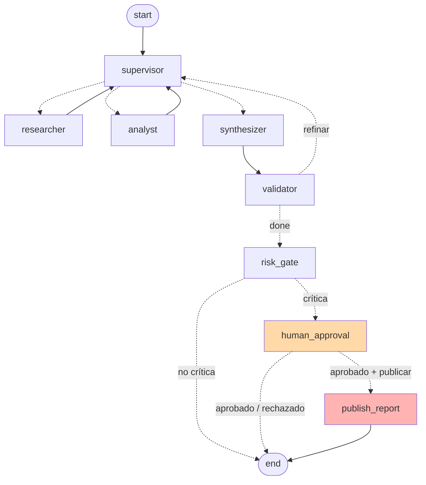

# Pre-entrega 7 · API de producción y monitoreo del orquestador multi-agente

API REST asíncrona (FastAPI) que expone el orquestador multi-agente del Módulo 6
(supervisor → investigador / analista → sintetizador → validador, en LangGraph) con:

| Requisito | Implementación |
|---|---|
| **Endpoints asíncronos** | `POST /tasks` encola en Redis y responde `202` con `job_id` en ~15 ms; `GET /tasks/{id}` para polling. La API solo usa `redis.asyncio`: nunca ejecuta el grafo ni hace I/O síncrona en el event loop. |
| **Worker** | Proceso separado (`python -m app.worker`) que consume la cola de Redis con concurrencia configurable (o `WORKER_MODE=inline` para correrlo dentro de la API). |
| **Estado en Redis** | Estado del job en un hash `job:{id}` (`PENDING → RUNNING → AWAITING_APPROVAL → DONE / FAILED`) + checkpoints de LangGraph con `AsyncRedisSaver` (`thread_id = job_id`). |
| **Manejo de errores** | Cualquier excepción o timeout del job en segundo plano se captura y el job pasa a `FAILED` con el error: el cliente nunca queda en un polling infinito. |
| **Observabilidad** | Arize Phoenix vía OpenInference (cada nodo del grafo, llamada al LLM con tokens y herramienta es un span; el `job_id` es la sesión). LangSmith como alternativa por variables de entorno. |
| **Human-in-the-loop** | Nodo `human_approval` con `interrupt()` que pausa las tareas **críticas** hasta `POST /tasks/{id}/approve`. |

La documentación del orquestador del M6 (agentes, herramientas, guardas anti-bucle) está en [`docs/orquestador_m6.md`](docs/orquestador_m6.md).

## Arquitectura

```
 cliente ──POST /tasks──▶ FastAPI ──RPUSH jobs:queue──▶ Redis ◀──BLPOP── worker (N jobs en paralelo)
    ▲                       │  HSET job:{id} PENDING        ▲               │ graph.ainvoke(thread_id=job_id)
    └──GET /tasks/{id}──────┘                               │               │ AsyncRedisSaver (checkpoints)
                                                            └── estado ─────┘ OpenInference ──▶ Phoenix :6006
```

### Grafo de producción



(Generado desde el grafo compilado en [`docs/graph_api.mmd`](docs/graph_api.mmd) / [`docs/graph_api.png`](docs/graph_api.png).)

### Human-in-the-loop: ¿qué es una tarea crítica?

`risk_gate` (determinista, sin LLM) marca la tarea como crítica si se cumple alguna de estas condiciones:

| Razón | Cuándo |
|---|---|
| `side_effect` | La petición implica la herramienta `publish_report`, que escribe el informe en `reports/` (efecto secundario fuera del sistema). Se detecta en la pregunta (“publica”, “envía”, “comparte”…) o con `"publish": true`. |
| `high_cost` | La ejecución consumió más de `HITL_TOKEN_THRESHOLD` tokens (contados con `UsageMetadataCallbackHandler`). |
| `low_quality` | El validador cerró por límite de revisiones sin aprobar. |
| `requested` | El cliente envió `"require_approval": true`. |

Si es crítica, `human_approval` llama a `interrupt()`: el estado queda en los checkpoints de Redis, el job pasa a `AWAITING_APPROVAL` y `GET /tasks/{id}` muestra las razones y el borrador. La aprobación puede llegar mucho después y la procesa cualquier worker (el estado no vive en memoria). Al aprobar se reanuda con `Command(resume=...)`; si se rechaza, la respuesta se retiene y `publish_report` **no** se ejecuta.

## Estructura

```
├── app/
│   ├── main.py            # FastAPI: POST /tasks · GET /tasks/{id} · GET /tasks · GET /health
│   ├── graph.py           # orquestador M6 + risk_gate/HITL + AsyncRedisSaver
│   ├── worker.py          # consume la cola, ejecuta el grafo, PENDING/RUNNING/AWAITING_APPROVAL/DONE/FAILED
│   ├── store.py           # estado de los jobs y cola en Redis (redis.asyncio)
│   ├── observability.py   # Phoenix (OpenInference) / LangSmith, decorador @traced, conteo de tokens
│   └── hitl.py            # risk_gate, human_approval (interrupt), publish_report, POST /tasks/{id}/approve
├── agents/ tools/ state.py graph.py llm.py config.py   # orquestador del Módulo 6 (sin cambios de lógica)
├── scripts/load_test.py   # 5 peticiones concurrentes + polling + p50/p95 del lado cliente
├── tests/                 # tests offline (LLM guionizado + fakeredis): API, HITL, FAILED, grafo M6
├── screenshots/           # capturas de Phoenix (trazas, costo por ejecución, latencia p95)
├── docker-compose.yml     # redis:8 + phoenix + api + worker
├── Dockerfile
├── requirements.txt
└── .env.example
```

## Cómo levantarlo

Requiere Python 3.12+ y Docker (para Redis 8 y Phoenix).

```bash
cp .env.example .env    # rellena GOOGLE_API_KEY (o ANTHROPIC_API_KEY + LLM_MODEL)
```

### Opción A · Todo con Docker Compose (recomendado)

```bash
docker compose up --build
```

- API + Swagger: http://localhost:8000/docs
- Phoenix: http://localhost:6006
- Redis: `localhost:6380` (publicado en 6380 para no chocar con otro Redis local)

Si los puertos 8000 o 6380 están ocupados: `API_PORT=8010 REDIS_PORT=6390 docker compose up --build`.

### Opción B · Redis y Phoenix en Docker, API y worker en local

```bash
docker compose up -d redis phoenix
```

```bash
python3.12 -m venv .venv && source .venv/bin/activate && pip install -r requirements.txt
```

```bash
uvicorn app.main:app --port 8000
```

En otra terminal:

```bash
python -m app.worker
```

(O un solo proceso con `WORKER_MODE=inline uvicorn app.main:app`.)

> Redis tiene que ser **Redis 8 o Redis Stack**: `AsyncRedisSaver` usa los módulos RedisJSON y RediSearch. Un `redis:7` normal falla al crear los índices.

## Uso de la API

```bash
curl -s -X POST localhost:8000/tasks -H 'content-type: application/json' \
  -d '{"question": "¿Cuánto crecieron los usuarios activos de NovaPay entre Q1 y Q4 de 2024?"}'
# {"job_id":"9f0c…","status":"PENDING","status_url":"/tasks/9f0c…"}
```

```bash
curl -s localhost:8000/tasks/<job_id>
```

Tarea crítica (efecto secundario) → se pausa para aprobación:

```bash
curl -s -X POST localhost:8000/tasks -H 'content-type: application/json' \
  -d '{"question": "Analiza el crecimiento de ingresos de NovaPay en 2024 y publica el informe"}'
# … GET /tasks/<job_id> → "status": "AWAITING_APPROVAL", "interrupt": {"reasons": ["side_effect: …"], "draft": "…"}
```

```bash
curl -s -X POST localhost:8000/tasks/<job_id>/approve -H 'content-type: application/json' \
  -d '{"approved": true, "reviewer": "ara", "comment": "ok"}'
# → el worker reanuda el grafo, ejecuta publish_report y el job pasa a DONE con "published_to": "reports/<job_id>.md"
```

Ejemplo de respuesta de `GET /tasks/{id}` al terminar:

```json
{
  "job_id": "…", "status": "DONE", "question": "…",
  "result": "…respuesta final…",
  "critical_reasons": ["side_effect: la tarea ejecuta publish_report (escribe/distribuye el informe)"],
  "approval": {"approved": true, "reviewer": "ara", "comment": "ok", "decided_at": "…"},
  "published_to": "reports/….md",
  "agent_calls": {"researcher": 1, "analyst": 2}, "step_count": 5, "revision_count": 1,
  "tokens_total": 41235, "duration_s": 74.2
}
```

Si el agente falla (cuota del proveedor, timeout de `JOB_TIMEOUT_S`, error de herramienta…), el job queda en `"status": "FAILED"` con `"error"`.

## Prueba de carga: 5 peticiones concurrentes

Con la API y el worker levantados:

```bash
python scripts/load_test.py --url http://localhost:8000
```

Lanza 5 preguntas distintas a la vez (la última pide publicar el informe → pasa por HITL y el script la aprueba automáticamente; `--no-approve` la deja esperando para aprobarla a mano), hace polling hasta que terminan e imprime por job el estado, la latencia, los tokens y si pasó por HITL, más p50/p95 del lado del cliente como referencia.

> Con el free tier de Gemini (`LLM_RPM=8`) las 5 ejecuciones comparten el limitador del worker y la corrida tarda varios minutos. Es lo esperado.

## Observabilidad y capturas

Phoenix (http://localhost:6006) → proyecto **`pre7-multiagente`**:

- **Trazas**: cada ejecución de un job es una traza con raíz `job.execute` y, debajo, cada nodo (`supervisor`, `researcher`, `analyst`, `synthesizer`, `validator`, `risk_gate`, `human_approval`, `publish_report`), cada llamada al LLM con tokens de entrada/salida y cada herramienta. La ejecución inicial y la reanudación tras la aprobación comparten `session.id = job_id` (pestaña **Sessions**).
- **Costo por ejecución**: Phoenix lo calcula solo a partir de los tokens y el modelo de cada span LLM. Columna *Cost* en **Traces**, total por job en **Sessions** y gráfico *Cost* en **Metrics**. Si el costo sale en $0 con tokens > 0, el modelo no está en la tabla de precios de Phoenix: agregá su precio en *Settings* (configuración de modelos/precios).
- **Latencia p95**: pestaña **Metrics** → gráfico *Trace latency* (percentiles P50/P75/P90/**P95**/P99).
- **Lectura del dashboard**: ordená los spans LLM por tokens para ver qué nodo consume más, y abrí la traza más lenta para ver dónde se concentra la latencia.

LangSmith como alternativa: deja `PHOENIX_COLLECTOR_ENDPOINT` vacío y define `LANGSMITH_TRACING=true`, `LANGSMITH_API_KEY` y `LANGSMITH_PROJECT`.

### Capturas (`/screenshots`)

| Archivo | Contenido |
|---|---|
| [`01_traces.png`](screenshots/01_traces.png) | Trazas `job.execute` de la corrida de 5 peticiones concurrentes (+ la prueba de rechazo) |
| [`02_trace_detail.png`](screenshots/02_trace_detail.png) | Árbol de una traza: supervisor → researcher (agente ReAct, `ChatGoogleGenerativeAI`, `search_knowledge_base`)… con latencia, tokens y costo por span |
| [`03_hitl_session.png`](screenshots/03_hitl_session.png) | Sesión del job con HITL: turno 1 termina en `AWAITING_APPROVAL` (razón `side_effect`), turno 2 es la reanudación tras aprobar |
| [`04_cost_per_execution.png`](screenshots/04_cost_per_execution.png) | Columnas latency / total tokens / total cost de cada ejecución |
| [`05_latency_p95.png`](screenshots/05_latency_p95.png) | Metrics → Trace latency: **p95 = 370,49 s** en la corrida concurrente; gráfico Cost con prompt/completion |
| [`06_sessions.png`](screenshots/06_sessions.png) | Sesiones (una por job) con duración P50/P99 |

**Resultado de la corrida** (Gemini `gemini-3.5-flash-lite`, `LLM_RPM=8`): 5/5 jobs en `DONE`, `POST /tasks` ≤ 12 ms, 63.832 tokens y **≈ $0,039 en total → ≈ $0,008 por ejecución** (entre $0,0067 y $0,0104), **p95 ≈ 370 s**. Phoenix redondea el costo de cada fila a `<$0.01`; el valor exacto está en el detalle de la traza o de la sesión.

**Lectura del dashboard:** los nodos que más tokens consumen son `analyst` (~18 k) y `supervisor` (~19 k en 18 decisiones), porque reciben como contexto todas las aportaciones acumuladas; la entrada (prompt) pesa ~6 veces más que la salida. La latencia se concentra en `researcher` (~97 s por invocación) y `analyst` (~60 s): no es el modelo, sino la espera en el limitador de 8 peticiones/min que comparten los 5 jobs concurrentes.

## Tests

```bash
pytest -q
```

Sin red ni API key: un LLM guionizado ejecuta el grafo con las herramientas reales y `fakeredis` reemplaza a Redis. Cubren que `POST /tasks` responde sin ejecutar el grafo, el paso a `DONE`, el paso a `FAILED` cuando el LLM lanza una excepción en segundo plano, la pausa HITL (la herramienta con efectos secundarios no se ejecuta antes de aprobar), la aprobación (`publish_report` escribe el informe), el rechazo, y el `409` ante una doble aprobación. Además se probó contra `redis:8` real con `AsyncRedisSaver`: un job pausado se reanuda desde un checkpointer nuevo, como si el worker se hubiera reiniciado.

## Variables de entorno

Ver [`.env.example`](.env.example). Las principales: `REDIS_URL`, `WORKER_MODE`, `WORKER_CONCURRENCY`, `JOB_TIMEOUT_S`, `HITL_TOKEN_THRESHOLD`, `PHOENIX_COLLECTOR_ENDPOINT`, `PHOENIX_PROJECT_NAME`, `LLM_MODEL`, `LLM_RPM`.

> Los datos de `data/knowledge_base.json` corresponden a una empresa ficticia (NovaPay) creada para el ejercicio.
