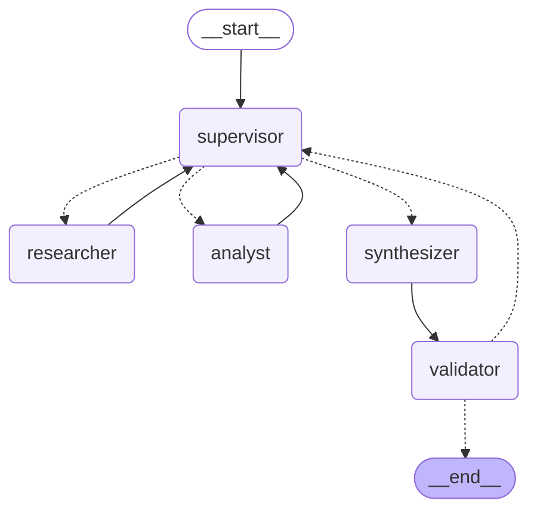

# Pre-entrega 6 · Orquestador multi-agente de análisis e investigación

Prototipo en **LangGraph** de un sistema jerárquico: un **Supervisor** enruta la petición del usuario entre un **Agente Investigador** (búsqueda en fuentes) y un **Agente Analista** (cómputo), y después una fase de **síntesis** y un nodo de **validación** con rúbrica deciden si se entrega la respuesta o si hay que refinar.

## Diagrama del grafo

Generado con `graph.get_graph().draw_mermaid()` (`python main.py --diagram` → [`docs/graph.mmd`](docs/graph.mmd) y [`docs/graph.png`](docs/graph.png)).



Líneas punteadas = aristas condicionales (`add_conditional_edges` con funciones que devuelven `Literal[...]`).

## Estructura del repositorio

```
├── state.py                 # OrchestratorState (hereda de MessagesState) + Contribution
├── graph.py                 # StateGraph: nodos, aristas condicionales, build_graph()
├── main.py                  # CLI: ejecuta y muestra el flujo de delegación; --diagram
├── config.py                # límites: MAX_STEPS, MAX_REVISIONS, MAX_CALLS_PER_AGENT
├── llm.py                   # fábrica de modelos (init_chat_model, configurable por env)
├── agents/
│   ├── research_agent.py    # create_react_agent + herramientas de búsqueda
│   ├── analyst_agent.py     # create_react_agent + herramientas de cómputo
│   ├── supervisor.py        # router con salida estructurada + guardas deterministas
│   ├── synthesizer.py       # síntesis final
│   ├── validator.py         # rúbrica de validación antes de END
│   ├── requirements.py      # qué herramienta exige cada tipo de pregunta (p. ej. sentimiento)
│   └── _specialist.py       # aislamiento de contexto + trazabilidad común
├── tools/
│   ├── search_tools.py      # search_knowledge_base (TF-IDF, Vector DB simulada) + Tavily opcional
│   └── analysis_tools.py    # calculator, growth_rate, descriptive_stats, sentiment_analysis
├── data/knowledge_base.json # corpus de la empresa ficticia "NovaPay" (informes, reseñas, benchmark)
├── demo.ipynb               # demo del flujo de delegación
└── tests/                   # tests de herramientas y del grafo completo con un LLM guionizado
```

## Instalación y uso

Requiere Python ≥ 3.10.

```bash
python3.12 -m venv .venv && source .venv/bin/activate
pip install -r requirements.txt
cp .env.example .env   # rellena GOOGLE_API_KEY (o ANTHROPIC_API_KEY); TAVILY_API_KEY es opcional
```

```bash
python main.py                                  # pregunta de demo
python main.py "¿Cómo evolucionó el churn de NovaPay frente al sector?"
python main.py --diagram                        # regenera docs/graph.mmd y docs/graph.png
pytest -q                                       # tests sin red ni API key
```

El proveedor se elige con `LLM_MODEL` (cualquier `proveedor:modelo` que acepte `init_chat_model`):

| Proveedor | `.env` |
|---|---|
| Gemini (free tier) | `GOOGLE_API_KEY=...`, `LLM_MODEL=google_genai:gemini-3.5-flash-lite`, `LLM_RPM=8` |
| Claude | `ANTHROPIC_API_KEY=...`, `LLM_MODEL=anthropic:claude-opus-5-5` |

`LLM_RPM` activa un `InMemoryRateLimiter` para no superar la cuota por minuto del free tier (una ejecución hace ~10-15 llamadas al LLM).

## Componentes

### Estado compartido (`state.py`)

`OrchestratorState` hereda de `MessagesState` y añade:

| Campo | Para qué sirve |
|---|---|
| `next_agent`, `current_instruction`, `supervisor_reasoning` | Decisión del supervisor: a quién, qué debe hacer y por qué (auditable). |
| `contributions: Annotated[list[Contribution], operator.add]` | Registro *append-only* de **qué agente aportó qué**: agente, paso, instrucción recibida, salida y herramientas usadas. |
| `agent_calls: Annotated[dict, merge_counts]` | Contador de invocaciones por especialista (reducer que suma). |
| `step_count`, `revision_count` | Contadores para las condiciones de parada. |
| `draft_answer`, `validation_feedback`, `task_completed`, `final_answer` | Síntesis y ciclo de validación. |

Los reducers hacen que las aportaciones nunca se sobrescriban: aunque un agente intervenga varias veces, todo queda trazado.

### Especialistas (`agents/`)

Ambos se construyen con `create_react_agent` y **herramientas acotadas a su rol**:

- **Investigador** → `search_knowledge_base` (búsqueda TF-IDF + coseno sobre `data/knowledge_base.json`, que simula la Vector DB de pre-entregas anteriores) y `web_search` (Tavily) si existe `TAVILY_API_KEY`. No puede calcular.
- **Analista** → `calculator` (evaluador AST seguro, sin `eval`), `growth_rate` (variación por periodo, total y compuesta), `descriptive_stats` y `sentiment_analysis` (léxico ES/EN con negaciones e intensificadores). No puede buscar. Todos los números salen de código determinista, no del LLM.

### Supervisor (`agents/supervisor.py`)

Usa `with_structured_output(SupervisorDecision)` donde `next_agent: Literal["researcher", "analyst", "synthesizer"]`, de modo que la respuesta se mapea directamente a nombres de nodo. Su prompt contiene una **rúbrica de suficiencia** (cada parte de la pregunta con datos citados, toda cifra derivada calculada por el analista, sin contradicciones, feedback del validador atendido).

### Síntesis y validación

`synthesizer` redacta la respuesta usando solo las aportaciones. `validator` puntúa el borrador con una rúbrica de 5 criterios (cobertura, trazabilidad de cifras, citas, ausencia de contradicciones y **métodos adecuados**). El quinto criterio se refuerza con una comprobación determinista (`agents/requirements.py`): si la pregunta pide sentimiento y el analista no ejecutó `sentiment_analysis` sobre los textos de las reseñas, el borrador se rechaza aunque el LLM lo apruebe. Una métrica parecida, como la valoración en estrellas, no sustituye al análisis pedido. Si falla, vuelve al supervisor con feedback dirigido al agente responsable; si aprueba, `END`.

## ¿Por qué esta topología?

- **Jerárquica con supervisor central** en lugar de una red donde los agentes se hablan entre sí: un único punto de decisión hace el flujo predecible, auditable (`supervisor_reasoning` en cada paso) y fácil de limitar. Con dos especialistas no compensa la complejidad de una red.
- **Especialistas en estrella que siempre vuelven al supervisor**: el supervisor ve cada resultado antes de decidir el siguiente paso, lo que permite pedir datos que faltan o recalcular.
- **Síntesis y validación como nodos separados** del supervisor: separar *quién decide el siguiente paso* de *quién juzga la calidad final* evita que el mismo prompt se apruebe a sí mismo y permite un bucle de refinamiento explícito.

## Manejo de conflictos y de bucles

**Conflictos entre agentes**

1. *Separación de responsabilidades por herramientas*: el investigador no puede calcular y el analista no puede buscar, así que no pueden "pisarse" con versiones distintas del mismo dato.
2. *Jerarquía de verdad*: el supervisor tiene instrucción explícita de que los **datos fuente del investigador mandan** sobre la interpretación; ante una discrepancia pide al analista recalcular con esos datos.
3. *Trazabilidad*: cada cifra de la respuesta debe poder rastrearse a una `Contribution`; el validador lo comprueba (`figures_traceable`) y devuelve el trabajo al agente responsable (`agent_to_refine`).

**"Supervisor infinito"** — tres guardas deterministas en código, independientes del LLM:

| Guarda | Efecto |
|---|---|
| `MAX_STEPS` (8) | Al agotarse, el supervisor fuerza `synthesizer` y declara lagunas. |
| `MAX_CALLS_PER_AGENT` (3) | Si el LLM pide de nuevo a un agente saturado, se fuerza la síntesis. |
| `MAX_REVISIONS` (2) | El validador cierra con un aviso aunque no apruebe. |

Además, una **guarda de suficiencia** impide sintetizar sin que ambos dominios hayan aportado, y cada agente ReAct interno tiene `recursion_limit` propio.

**Contaminación de contexto** — los especialistas **no reciben el historial global**. Cada uno arranca un hilo ReAct nuevo con solo:
- Investigador: pregunta original + instrucción del supervisor (+ feedback si es una revisión).
- Analista: instrucción + aportaciones del investigador.

Al canal `messages` global solo sube la salida final de cada agente, etiquetada con `name=<agente>`; los pasos intermedios de herramientas se quedan dentro del subagente.

## Demo

[`demo.ipynb`](demo.ipynb) muestra el diagrama, la ejecución real con la pregunta de demo (requiere API key) y la tabla de aportaciones por agente. La última sección ejecuta el mismo grafo con un LLM guionizado (herramientas reales) que incluye un rechazo del validador y una ronda de refinamiento:

```
🧭 supervisor (paso 1) → researcher
🔎 researcher usó ['search_knowledge_base']
🧭 supervisor (paso 2) → analyst
📊 analyst usó ['growth_rate']
🧭 supervisor (paso 3) → synthesizer
📝 synthesizer: borrador generado
✅ [validator] RECHAZADO (para analyst) Falta el análisis de sentimiento.
🧭 supervisor (paso 4) → analyst
📊 analyst usó ['sentiment_analysis']
🧭 supervisor (paso 5) → synthesizer
✅ [validator] APROBADO
```

> Nota: los datos de `data/knowledge_base.json` corresponden a una empresa **ficticia** (NovaPay) creada para el ejercicio.
